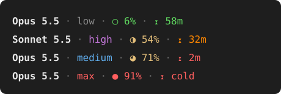

# claude-statusline

A compact status line for [Claude Code](https://code.claude.com) that shows the model, effort level, context usage and prompt cache time left.



```
Opus 5.5 · low · ○ 6% · ⧗ 58m
```

| Part | Symbol | Source | Colors |
|---|---|---|---|
| Model | | `model.display_name` | bold |
| Effort | | `effort.level` | gray low, blue medium, magenta high, red max |
| Context | `○ ◔ ◑ ◕ ●` | `context_window.used_percentage` | green < 50%, yellow < 80%, red after |
| Cache | `⧗` | `prompt_cache.expires_at` and `ttl` | green, orange, then red for each third of the TTL; `cold` once expired |

Values not yet reported (before the first reply, or right after `/compact`) show as `—`.

## Setup

Requires Node.js 23.6 or later, which runs TypeScript directly.

```sh
git clone https://github.com/WorldOccupier/claude-statusline.git
```

Add to `~/.claude/settings.json`:

```json
{
  "statusLine": {
    "type": "command",
    "command": "node /path/to/claude-statusline/statusline.ts",
    "refreshInterval": 1
  }
}
```

`refreshInterval` keeps the cache countdown ticking between turns.

## Development

```sh
npm install
npm test
npm run typecheck
```
